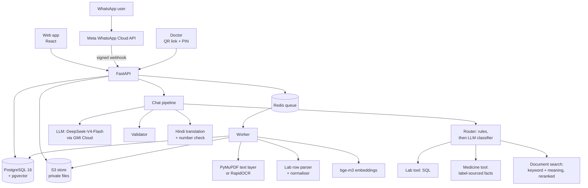

# 3. System design

## 3.1 Architecture

The web app and the WhatsApp bot share the same services: an upload from either path becomes the same document job,
and a question from either path goes through the same chat pipeline. Slow work (OCR, parsing, embedding, WhatsApp
replies) runs in a worker, so requests and webhooks return quickly.

## 3.2 Technology

| Layer | Choice | Why |
|---|---|---|
| Frontend | React 18 + TypeScript + Vite + Tailwind; Recharts for charts | Typed, fast to build; simple line charts with reference bands |
| Backend | FastAPI, Pydantic v2 | OCR and ML libraries are Python; Pydantic also validates the LLM's JSON |
| Database | PostgreSQL 16 + pgvector; SQLAlchemy 2 + Alembic (10 migrations) | One database for records, vectors and full-text search |
| Queue | Redis + RQ | Simple, enough for one worker type |
| Files | Any S3-compatible store (SeaweedFS locally) | Private bucket; the code only speaks S3 |
| Text and OCR | PyMuPDF for PDF text with word positions; RapidOCR (PaddleOCR models on ONNX Runtime) for photos | No PyTorch: the development machine had little disk and RAM |
| Search models | bge-m3 (embeddings, full precision) and bge-reranker-v2-m3 (8-bit), both ONNX on CPU | Multilingual, local, no PyTorch |
| LLM | Any OpenAI-compatible API behind one interface; GMI Cloud's DeepSeek-V4-Flash, the cheapest model that passed our checks | Swappable; a fake LLM in tests |
| Auth | Email + password, Argon2 hashing, signed session token in an httpOnly cookie | Standard, nothing hand-rolled |
| Sharing | `qrcode` for QR images | Doctor sheet links |

Two choices from the original plan changed during the build: MinIO stopped publishing public Docker images, so the
local store is SeaweedFS behind the same S3 API; and PaddleOCR with PyTorch didn't fit the disk, so RapidOCR runs the
same PaddleOCR models on ONNX Runtime. The doctor sheet is printed from the browser instead of a server-side PDF
library, which needed heavy system packages.

## 3.3 Data model

20 tables, in five groups:

| Group | Tables |
|---|---|
| Accounts and family | `users`, `profiles`, `profile_members` (user ↔ profile with a role) |
| Documents | `documents` (one uploaded file), `document_pages` (text and word boxes per page), `chunks` (search passages with embeddings) |
| Lab values | `lab_tests` (dictionary), `lab_results` (one row per extracted value: as printed, and converted to the test's canonical unit, with confidence and the page it came from) |
| Medicines | `drug_ingredients`, `drug_brands`, `drug_brand_ingredients`, `drug_lab_effects`, `profile_medicines`, `profile_medicine_ingredients` |
| Sharing and WhatsApp | `share_links`, `audit_events`, `whatsapp_links`, `whatsapp_link_codes`, `whatsapp_messages`, `whatsapp_pending_uploads` |

Every lab value keeps both what the report printed (`raw_value`, `raw_unit`, `raw_range`) and the canonical value.
The original file is the source of truth: everything else (pages, values, chunks) is derived from it and can be
rebuilt.

## 3.4 Rules the code never breaks

1. The browser never talks to the database, the file store or the LLM directly.
2. Every query on patient data is filtered by a `profile_id` that came from the server-side permission check, never
   from the LLM or the request body alone.
3. Numbers on charts come from SQL. Numbers in answers are validated against the evidence they cite.
4. Uploaded document text is untrusted data. It is passed to the LLM marked as data and can never change instructions
   or permissions.

## 3.5 Family profiles and permissions

A *profile* is a family member; a *user* is someone who logs in. `profile_members` links them with a role:

| Role | View | Edit | Share |
|---|---|---|---|
| owner | yes | yes | yes |
| caregiver | yes | yes | yes |
| viewer | yes | no | no |

Every profile-scoped route calls one function, `require_profile_access(user, profile, need)`. A user who is not a
member gets **404, not 403**, so the API doesn't reveal that a profile exists. Tests check that one user can never
list, read, download, chat about or share another user's family member, and the evaluation checks every cited source
for cross-profile leaks (0 found).

## 3.6 Testing

- **Backend:** 542 pytest tests against a separate test database, with S3 and Redis running. Tests use a fake LLM and
  stand-in search models, so they never call an API or load multi-GB models.
- **Frontend:** 70 Vitest + Testing Library tests against a fake backend, plus a TypeScript check.
- **CI** (GitHub Actions) runs the backend tests with the services, checks that the migrations match the models, runs
  the frontend tests, typecheck and build, and an extraction regression gate that fails if F1 drops more than 2
  points from the committed baseline, if any extracted value is wrong, or if document type or date accuracy falls.
- **Browser check:** every screen was driven in Chrome at desktop and phone widths (Section 7.4 and problem 5.4).
